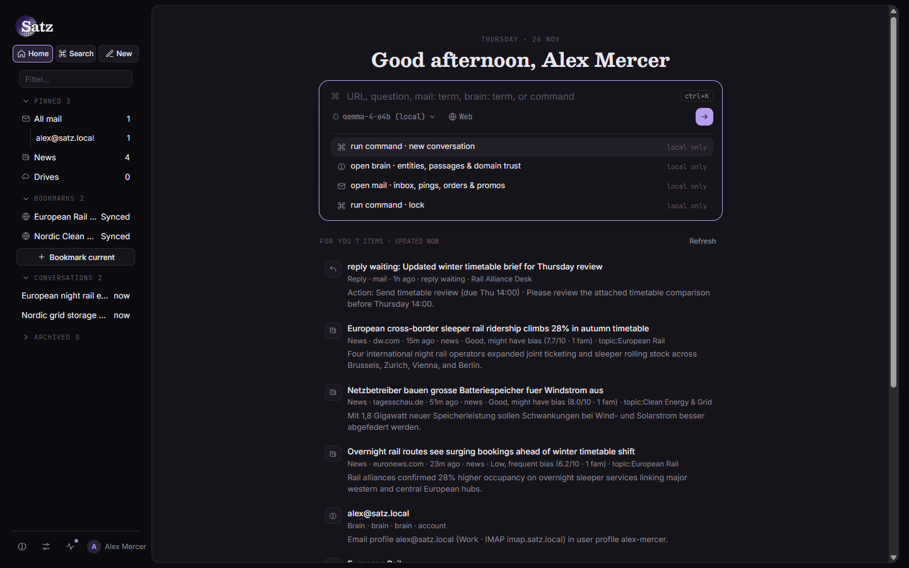

# Satz (`feamando/satz-browser`) — v0.5: Parity, Trust, Agents

**Satz** is a local-first, terminal-aesthetic AI-native desktop browser where **conversations are the workspace**, **tabs live inside a conversation**, and **Search, Mail, and Brain** are first-class surfaces powered by local models on your machine.

Built on **Tauri v2** (`WebView2` on Windows 11, `WKWebView` on macOS) and powered by local models from [`feamando/sgs`](https://github.com/feamando/sgs) (**Gemma 4 E4B**, **Planck 3.0**, **Hertz 1.2**, **Planck 1.3/1.5** cross-readers, **Planck 13** semantic encoder, and a local **DistilBERT** 4-label mail classifier), Satz turns every browsed page, synced email, and stored Brain entity into a checked source that you can query, compare, watch, and cite inline with `[1]`, `[2]` and `[B1]`, `[B2]`.



---

## What Changed in v0.5 (`docs/PLAN_v0.5.md`)

1. **Platform Parity & Model Doctor (M16):**
   - **Device Selection (`cuda > mps > cpu`) & Streaming Heartbeat:** `ensure_gemma()` automatically selects `cuda` (Windows/Linux NVIDIA GPU), `mps` (macOS Apple Silicon `bfloat16`), or `cpu`, displaying `gemma [warm · cuda|mps|cpu]` in the status bar. `/chat` emits an SSE heartbeat every `2 s` during prompt prefill (`warming up gemma · Ns`) and aborts cleanly after `30 s` of token silence (`gemma stopped responding after 30 s.`).
   - **Native macOS `WKWebView` DOM Capture (`objc2-web-kit`):** Child tabs on macOS capture live rendered DOM (`visible_text`, `html`, `findings`) via `WKWebView.evaluateJavaScript:completionHandler:` in Rust (`src-tauri/src/webview_manager.rs`) with no page-reachable bridge.
   - **Toolbar Bounds, Honest User-Agent & Cross-Platform Settings:** Child webview bounds enforce `y = max(rect.top, toolbar_bottom)` so native webviews never cover the site toolbar (`<-`, `->`, `[reload]`, address bar, `[codes (N)]`, `[fill login]`, `[watch]`, `[chat rail Mod+J]`). Child webviews send a platform-appropriate modern User-Agent (`Safari/605.1.15 Satz/0.5` on macOS; `Chrome/131.0.0.0 Safari/537.36 Satz/0.5` on Windows) and normalize path separators across OSes (`normalize_cross_platform_path`).
   - **`GET /doctor` & Settings Model Doctor:** Reports per-role readiness (`ready | missing | cpu_only`), device, checkpoint path, and a one-line fix for `gemma-4-e4b`, `planck3 (web)`, `hertz (reader)`, `planck (reader)`, `planck13` (Brain encoder), and `distilbert-mail`.

2. **Honest Sources & Shell Polish (M17):**
   - **Honest Capture Accounting:** `ingest_page` records `capture_mode: "dom" | "fetch" | "timeout"`. Tabs with `0` captured chars are excluded from the model prompt and shown as `empty [recapture]` in the context bar; public-fetch fallbacks show `public fetch`. When all open tabs are empty and `+ web` is off, Satz shows an inline recovery banner (`[recapture]`, `[turn on + web]`, `[ask without pages]`). `check_citations` flags any citation to a 0-char source as `[unsourced]`.
   - **Plain-English Errors, Overlays & Inline Unlock (+ Touch ID):** Raw Python tracebacks are mapped to one-line human summaries with `[retry]`, `[use planck instead]`, and `[debug]`. Child webviews hide whenever Settings, Brain, or the Command Bar overlay is open. Locked views (Mail, Brain) unlock in place with a 6-digit PIN or macOS Touch ID / OS keychain (`POST /profile/unlock_keychain`). First-run migration (`db_version = 2`) removes legacy seed conversations.

3. **Brain & Profile Integrity (M18):**
   - **Profile-Scoped Planck Store & Migration:** Each unlocked profile owns `profiles/<id>/planck_store.sqlite` (and `:memory:` when locked). Existing shared `planck_store.sqlite` files are backed up to `planck_store.sqlite.bak` and migrated automatically on first unlock.
   - **Entity Quality Guards, Clean Bookmark Entities & Cascading Deletes:** `is_valid_entity_name` rejects conversational artefacts (`Here are`, `[bookmark]`, URLs, sentences `> 60` chars, stopwords). Bookmarks strip `[bookmark]` prefixes and extract clean subject entities. `/digest` deduplicates to at most 1 item per URL and 2 per domain (`changed:` and `watch:` items replace older entries for the same URL). Deleting a conversation, passage, or entity cascades cleanly across `passages`, `edges`, and `queries`.

4. **Mail Cold Start & Actionable Extraction (M19):**
   - **Cold-Start Heuristic & Gemma JSON Confidence:** Before DistilBERT reaches 50 labels, a deterministic header/domain/keyword classifier (`List-Id`, `List-Unsubscribe`, `Auto-Submitted`, `Precedence: bulk`, order/shipping subjects, platform notifications) routes obvious pings, orders, and promotions immediately and asks Gemma for `{label, confidence}` on ambiguous messages.
   - **Relabel Re-Extraction, 5-Card Onboarding, Order Cards & `[new]` Recipient Badge:** Moving a message with keys `1`–`4` (`record_user_correction`) re-runs structured extraction (`order_info` / `promo_info` / `ping_info`) and updates the Brain entity. Cold-start Mail surfaces a 5-card inline onboarding strip, renders rich order cards (merchant, status badge, carrier, tracking link, delivery date, items), flags never-before-emailed recipients with `[new]` in the send gate, and surfaces `[codes (N)]` on matching shopping tabs.

5. **A Brain You Can Use (`Mod+B`) (M20):**
   - **Dedicated Brain View (`Mod+B`) vs Settings:** The left rail footer splits `[brain · Mod+B]` (`renderBrainView`) and `[settings]` (`renderKnowledgeView`).
   - **Unified Brain Search (`/brain/search`):** Searches entities, passages, and mail in one box using `planck13` semantic embeddings + lexical/FTS5 ranking.
   - **Domain Trust Sliders with 30% Hard Cap:** Every domain row in Brain displays its hand-scored system trust (`0..10`), category, and reason (`why`), alongside a personal trust slider (`0..10`) capped at **30% influence** (`effective = 0.7 * system + 0.3 * yours`), a conflict badge when `|personal - system| >= 3.0`, and `[reset]`.
   - **`"this week"` Timeline & `[B1]` Memory Citations:** Brain shows a chronological `"this week"` timeline of read pages and received mail. Relevant Brain entities are injected into chat context as `[B1]`, `[B2]`, verified by `check_citations`, and rendered as clickable `[B1] <Entity Name>` chips that open the entity card in Brain.

6. **One Command Bar (`Mod+K`) (M21):**
   - **Unified Start Screen & `Mod+K` Modal (`rankCommandBarRoutes` / `GET /command/route`):** Replaces the separate rail filter input and unifies the Start screen input and `Mod+K` overlay into one Command Bar.
   - **Ranked Routes & Explicit Privacy Disclosures:** Typing any line (`dw.com`, `dw.com what are the top stories today?`, `what is the capital of Portugal?`, `mail: Jordan Reyes`, `brain: zalando`, `lock` / `compare` / `bookmark` / `new conversation`) lists ranked routes before `Enter` with `ArrowUp`/`ArrowDown` navigation and an explicit privacy disclosure on every route (`[local only]`, `[loads <domain>]`, `[loads <domain> · local model]`, or `[web search · duckduckgo]`).

7. **First Agents: Task Cards, Comparer, Watcher (M22):**
   - **Task Cards & Single-Use Send-Gate Tokens:** Every agent task is a typed object (`{id, conversation_id, agent, goal, steps[], status, started_at, stop_token, result_md}`) rendered in chat with live steps, `[stop]`, and a final result block. Any step that would commit (`send_gate`) requires user confirmation (`[confirm] [cancel]`) with a single-use `confirm_token`.
   - **Comparer Agent (`POST /agent/compare`):** In Compare View (`[compare these]`) or chat (`compare these`), the Comparer reads 2–4 sources, extracts `Price`, `Key specs`, `Availability`, and `Source`, and pins a Markdown comparison table where every cell cites its source `[1]`..`[4]` (`0 uncited cells`).
   - **Watcher Agent (`POST /watch/add`, `POST /watch/check`):** Any open page or assistant answer can become a watch (`[watch]`), stored in `satz_watches` and the Planck `watches` table. Value/price changes surface at the top of `For you` (`/digest`) as `watch: <title> (<old> -> <new>)` and display a `[watch !]` badge on the conversation in the left rail.

---

## Keyboard Shortcuts (`Mod` = `Ctrl` on Windows, `Cmd` on macOS)

### Global Browser Shortcuts
| Shortcut | Action |
| :--- | :--- |
| `Mod+K` | Open Command Bar (route URL, URL+question, question, mail, brain, or command) |
| `Mod+B` | Open Satz Brain view (search entities/passages/mail, entity cards, this week, trust sliders) |
| `Mod+N` | New conversation (Start Screen) |
| `Mod+T` | New site tab in the active conversation (focuses address bar) |
| `Mod+W` | Close active site/email/compose tab (`chat` tab cannot be closed) |
| `Mod+1` | Switch to `[1 chat]` tab |
| `Mod+2` .. `Mod+9` | Switch to tab `2` .. `9` |
| `Mod+L` | Focus address bar of the current site tab |
| `Mod+Shift+L` | Fill login credentials from unlocked vault on exact host match (never auto-submits) |
| `Mod+J` | Toggle collapsible chat/agent rail on a site or email tab |
| `Mod+M` | Toggle Compare View (tile 2 to 4 selected tabs) |
| `Mod+D` | Bookmark the current page (hooks up 30-min background indexing) |
| `Mod+F` | Native find-in-page |
| `Esc` | Close Command Bar / Brain / Settings overlay or exit Compare View |

### Mail Lane & Message Shortcuts (when no text input is focused)
| Shortcut | Action |
| :--- | :--- |
| `j` / `k` | Move selection down / up in the active mail lane |
| `Enter` | Open the selected email in a `satzmail://` tab |
| `r` | Reply to the active or selected email in a `compose` tab |
| `c` | Open a new blank `compose` tab |
| `e` | Hide (archive locally in `mail.sqlite`; never deletes on server) |
| `1` / `2` / `3` / `4` | Move message to `1 inbox` (`email`), `2 pings`, `3 orders` (`information`), or `4 promos` (records correction + re-runs extraction) |
| `/` | Focus FTS5 mail search bar |
| `Mod+Enter` | Prepare send confirmation (`[confirm] [cancel]`) in a `compose` tab |

---

## Security & Trust Model Summary

| Boundary | Enforcement |
| :--- | :--- |
| **Sidecar HTTP (`127.0.0.1:8020`)** | Per-launch 32-byte CSPRNG token (`X-Satz-Token`), `Host` allowlist (`127.0.0.1:<port>`, `localhost:<port>`), and strict `Origin` allowlist (`http://tauri.localhost`, `tauri://localhost`, `http://localhost:1420`). |
| **Password Vault (`vault.enc`)** | `AES-256-GCM` with `HKDF-SHA256(Argon2id(PIN, salt16) || OS_keychain_device_key)`. Exponential lockout (`30s` -> `1h`) after 5 failed PIN attempts; 30-minute inactivity autolock; optional macOS Touch ID / OS keychain unlock. |
| **Profile-Scoped Brain & Store** | Each profile isolates `profiles/<id>/planck_store.sqlite`, `profiles/<id>/mail.sqlite`, and `profiles/<id>/brain/`. When locked, the Planck store is `:memory:` and `SatzBrain` refuses reads and writes. |
| **30% Personal Trust Cap** | Domain trust blends `0.7 * system + 0.3 * personal` (`Store.set_personal`). Personal trust can never override more than 30% of the hand-scored system trust registry. |
| **Honest Citations (`[n]` & `[Bn]`)** | Empty (`0 char`) tabs are excluded from prompts and cannot be cited (`[unsourced]`). `check_citations` verifies numbers, dates, and capitalized names against both `[n]` page/mail sources and `[Bn]` Brain entities. |
| **Read / Act Boundary & Send Gates** | Page and email text never authorizes actions. `<brain_store>` in sources is neutralized (`‹brain_store›`). Agent Task Cards (`POST /task/confirm`) and outgoing SMTP mail (`POST /mail/send`) require an explicit user click on `[confirm]` with a single-use `confirm_token`. |

---

## Repository Structure

```text
satz-browser/
├── .gemini/
│   └── antigravity.md                # Workspace rules & monochrome terminal constraints
├── docs/
│   ├── PLAN_v0.5.md                  # Full Satz v0.5 specification (M16-M23)
│   ├── NOTES_v0.5.md                 # v0.5 milestone measurements, latency logs & gate summary
│   ├── PLATFORMS.md                  # macOS (WKWebView / MPS) & Windows (WebView2 / CUDA) parity matrix
│   ├── REVIEW_v0.4_macos.md          # macOS v0.4 dogfood review that motivated v0.5
│   └── smoke/                        # 12-email local IMAP fixture + per-milestone smoke artifacts (m16..m23)
├── public/
│   └── fonts/                        # Bundled JetBrains Mono (Regular & Bold woff2)
├── sidecar/
│   ├── satz_models.py                # Local model HTTP sidecar (/doctor, /chat, /answer, /read, /brain/search, /command/route, /agent/compare, /watch/*, /task/*)
│   ├── satz_brain.py                 # Profile-scoped Brain entity graph, guards, [B1] citations, shared planck13 encoder
│   ├── satz_passwords.py             # Argon2id + OS keychain + AES-256-GCM vault.enc & per-profile store paths
│   ├── satz_mail.py                  # Mail accounts, IMAP PEEK / POP3 UIDL sync, lanes, order cards, [new] recipient check
│   ├── satz_mail_pipeline.py         # EN/DE splitter, cold-start heuristic, DistilBERT + Gemma JSON confidence, relabel re-extractor
│   └── test_m16.py .. test_m22.py    # Comprehensive unit & integration test suites (M5-M22)
├── src/                              # Modular TypeScript frontend
│   ├── main.ts                       # App shell orchestration, Brain/Settings/Compare/Site/Mail viewports, Comparer & Watcher actions
│   ├── start.ts                      # Unified Start screen & Mod+K Command Bar with ranked routes and privacy disclosures
│   ├── knowledge.ts                  # Split Brain view (Mod+B: search, cards, this week, trust sliders) & Settings view
│   ├── chat.ts                       # Chat thread, Task Cards, Markdown tables, [n] & [Bn] citations, [watch] & [compare these]
│   ├── mail.ts                       # Mail lanes, 5-card onboarding, order cards, inline unlock, compose send gate
│   ├── rail.ts                       # Left rail ([> command bar], pinned Mail, [watch !] badges, bookmarks, [brain] & [settings])
│   ├── sources.ts                    # Context panel (empty [recapture], public fetch, chars_sent/captured)
│   ├── api.ts                        # Tauri invoke + authenticated sidecar HTTP/SSE client
│   ├── state.ts                      # App state, URL/command route classifier, plain error mapper
│   ├── keys.ts                       # Cross-platform Mod keyboard shortcuts (Mod+K, Mod+B, Mod+J, Mod+M, Mod+Shift+L)
│   ├── status.ts                     # Bottom status line (gemma [warm · device], mail progress, [N errors] overlay)
│   ├── types.ts                      # Shared TypeScript interfaces
│   └── style.css                     # Strict monochrome terminal CSS (#000000..#e8e8e8, border-radius: 0)
└── src-tauri/                        # Rust + Tauri v2 backend
    └── src/
        ├── db.rs                     # SQLite schema + v2 clean-first-run migration
        ├── webview_manager.rs        # Per-tab WebView2 / WKWebView (objc2) capture, toolbar bounds guard, modern UA
        ├── lib.rs                    # Cross-platform settings defaults, CSPRNG token, satzmail:// handler, sidecar lifecycle
        └── main.rs                   # Application entry point
```

---

## Building, Testing & Running

```powershell
# 1. Frontend TypeScript + Vite build
npm run build

# 2. Rust compile & unit tests (12 tests: cross-platform settings, toolbar bounds, v2 migration, LRU cap, capture deadline)
cargo check --manifest-path src-tauri/Cargo.toml
cargo test --manifest-path src-tauri/Cargo.toml

# 3. Python sidecar pytest suite (29 test modules/cases covering M5 through M22)
..\sgs\.venv\Scripts\python.exe -m pytest sidecar -q
```
