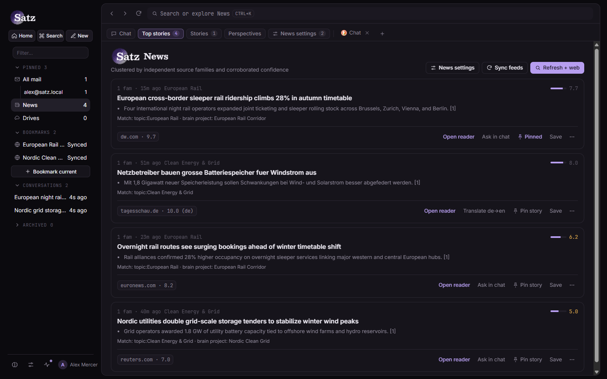

# Satz (`feamando/satz-browser`)

**Satz** is a local-first AI-native desktop browser where **conversations are the workspace**, **tabs live inside a conversation**, and **Search, Mail, News, Cloud Drives, and Brain** are first-class surfaces powered by local models on your machine (with opt-in BYOK cloud support).

Built on **Tauri v2** (`WebView2` on Windows 11, `WKWebView` on macOS) with a modular **TypeScript** frontend, **Rust** backend, and local **Python** AI sidecar bundling **Planck 3.0** (`planck_vendor/` + sharded `planck13` encoder and `xreader_planck` reader weights), **Gemma / Qwen / HuggingFace** local models (`satz_local_models.py`), and a local **DistilBERT** 4-label mail classifier, Satz turns browsed pages, synced emails, news clusters, cloud drive metadata, and Brain entities into grounded sources cited inline with `[1]`, `[2]` and `[B1]`, `[B2]`.


<details>
<summary>Satz News: Corroborated clusters, pinned Stories, Perspectives & News Settings</summary>



</details>

---

## Core Capabilities

1. **Conversations-as-Tabs Browser Shell & Design System**
   - **Unified Workspace:** Conversations replace scattered tab bars; open web tabs, `satzmail://` emails, compose drafts, and Compare View (`Mod+M`) live inside each conversation with a collapsible AI agent side rail (`Mod+J`).
   - **Design System (`src/design-system/`):** Built on tokenized light, dark, and system themes (`Besley`, `Inter`, `JetBrains Mono`) with switchable `floating` and `flush` layouts (`docs/design/DESIGN_SYSTEM.md`).
   - **Command Bar (`Mod+K`) & Start Screen:** Ranks navigation (`dw.com`), page Q&A, mail/brain search, and workspace commands with explicit privacy disclosures before execution.
   - **Agents & Send Gates:** Typed **Task Cards** with `[stop]` cancellation, **Comparer** agent (cited 2–4 tab comparison tables), **Watcher** agent (value/price monitoring surfaced in Home digest and rail badges), and single-use `confirm_token` send gates (`[confirm] [cancel]`) before any state-changing action.

2. **Encrypted Profiles, Vault & Offline Profile Portability**
   - **Hardware-Bound Local Vaults (`vault.enc`):** Protected by `AES-256-GCM` with `HKDF-SHA256(Argon2id(6-digit PIN, salt16) || OS_keychain_device_key)`, exponential wrong-PIN lockout (`30s` to `1h`), 30-minute inactivity autolock, and optional OS keychain / macOS Touch ID unlock (`POST /profile/unlock_keychain`).
   - **Strictly Profile-Scoped Storage:** Each unlocked profile isolates `profiles/<id>/planck_store.sqlite`, `mail.sqlite`, `drives.sqlite`, `mail_model/`, and `brain/`. When locked, the Planck store is `:memory:` and `SatzBrain` refuses reads and writes.
   - **Offline Profile Export & Upload (`satz_profile_bundle.py`):**
     - **Export** (Settings -> Profiles) generates an encrypted `.satzprofile` backup sealed solely with the profile's 6-digit PIN (`Argon2id` + `HKDF-SHA256` + `AES-256-GCM` over zlib-compressed JSON) without exposing plaintext metadata or depending on the source machine's OS keychain.
     - **Upload profile** (available from the Unlock Modal, Start card, inline Mail/News/Drive gates, and Settings -> Profiles) decrypts the bundle with its PIN and installs it as a local profile—excluding bulky re-fetchable caches (mail HTML/attachments, drive item trees, cached news articles) so bundles remain compact.
     - **UUID Most-Recently-Updated Merge:** Distinct profile UUIDs install alongside existing profiles (deduplicating directory slugs automatically). Matching UUIDs merge vault credentials/tombstones, `SatzBrain` Markdown entities & `registry.yaml`, trust overrides, news topics/feeds, providers, and mail/drive account configs by taking whichever edit is more recent (prompting for the local PIN if the two machines used different PINs).

3. **SatzBrain (`Mod+B`) & 30% Trust Rules**
   - **Human-Readable Memory Graph:** Stores entities (`person`, `company`, `project`, `story`, `claim`, `topic`, `source`, etc.), alias indexes, and pipe-delimited `BRAIN.md` summaries under `profiles/<id>/brain/`.
   - **PII Scrubber & Honest Citations:** Automatically strips private Brain names/emails/booking tokens before external web queries (`scrub_pii_for_external_query`). Empty (`0 char`) captures are excluded and checked via `check_citations` against `[n]` web/mail sources and `[Bn]` Brain entities.
   - **Domain Trust Sliders:** Blends system trust and personal trust with a hard 30% personal cap (`0.7 * system + 0.3 * personal`), highlighting divergence badges and offering a counterfactual system-only view.

4. **Mail & Local Classifier (`satz_mail.py`)**
   - **Pinned `conv-mail` Workspace:** Syncs IMAP (`BODY.PEEK`) and POP3 (forced leave-on-server), classifying into `Inbox`, `Pings`, `Orders`, and `Promos` via cold-start heuristics + DistilBERT + Gemma confidence fallback, retraining on user corrections (`1`–`4`).
   - **Structured Extraction:** Extracts tracking/order cards, shipping status, unsubscribe targets (`satz_unsubscribe`), and promotional/verification codes (`[codes (N)]` in shopping tabs).

5. **Satz News, Followed Stories & Perspectives (`satz_news.py`)**
   - **Five News Surfaces (`conv-news`):** `Chat`, `Top stories`, `Stories`, `Perspectives`, and `Settings`.
   - **Conditional RSS & Wire Collapsing:** Polls RSS/Atom feeds with `ETag`/`If-Modified-Since`, clusters articles, collapses syndicated wire stories (`AP`, `Reuters`, `AFP`, `DPA`, `DW`), and scores with your 30%-capped trust rules.
   - **Pinned Evolving Stories:** Pin any cluster to **Stories** so future auto-indexed articles append to its timeline and refresh a multi-source evolution overview.
   - **Streaming Perspectives & Conversational News Settings:** Select tracked topics, recent clusters, or pinned stories in **Perspectives** for streamed cross-source comparisons, or manage feeds, topics, and trust overrides via natural chat or manual accordions in News Settings.

6. **Zero-Disk Cloud Drives (`satz_drives.py`)**
   - Connects Google Drive (`satz_google_auth.py`) and Microsoft OneDrive in zero-disk metadata/index mode, syncing searchable summaries directly into `drives.sqlite` and Brain.

7. **Conversational Settings, App-Wide Localization & Self-Contained Packaging**
   - **Settings (`conv-settings`):** Switch seamlessly between **Chat** (powered by the declarative `satz_tools/` registry with RAM-only file staging and secret redaction) and **Manual settings** accordions (Profiles, Vault, Cloud/Local models & Model Doctor, Providers, Mail, Drives, Indexing, Appearance & Language).
   - **App-Wide i18n & Translation (`satz_i18n.py`, `satz_translate.py`):** Translates all UI strings across profiles (`scripts/i18n_extract.mjs`) using your selected local/cloud model, supports RTL layout mirroring, and translates Home digests, News stories, Emails, and open tabs on demand.
   - **Bundled Sidecar & Auto-Updater (`src/updater.ts`, `scripts/prepare_sidecar_bundle.py`):** Stages shipped Planck weights and Python runtime for standalone Tauri bundles (`src-tauri/tauri.bundle.conf.json`) with signed GitHub Release update checks via `@tauri-apps/plugin-updater`.

---

## Keyboard Shortcuts (`Mod` = `Ctrl` on Windows, `Cmd` on macOS)

### Global Browser Shortcuts
| Shortcut | Action |
| :--- | :--- |
| `Mod+K` | Open Command Bar (route URL, Q&A, mail, brain, or workspace command) |
| `Mod+B` | Open Satz Brain view (`Mod+B`: search entities/passages/mail, timeline, trust sliders) |
| `Mod+Shift+H` | Jump to Home / Start screen |
| `Mod+N` | New conversation |
| `Mod+T` | New site tab in active conversation (focuses address bar) |
| `Mod+W` | Close active site, email, or compose tab (`chat` tab stays pinned) |
| `Mod+Shift+W` | Archive active conversation |
| `Mod+1` .. `Mod+9` | Switch to tab `1` .. `9` |
| `Mod+L` | Focus address bar of the active site tab |
| `Mod+Shift+L` | Fill credentials from unlocked vault on exact host match (never auto-submits) |
| `Mod+J` | Toggle collapsible assistant/context side rail |
| `Mod+M` | Toggle Compare View (tile 2–4 tabs) |
| `Mod+D` | Bookmark active page (queues background indexing) |
| `Mod+F` | Native find-in-page |
| `Esc` | Close active overlay or exit Compare View |

### Mail Lane & Message Shortcuts (when no input is focused)
| Shortcut | Action |
| :--- | :--- |
| `j` / `k` | Move selection down / up in the active mail lane |
| `Enter` | Open selected email in a `satzmail://` tab |
| `r` | Reply in a `compose` tab |
| `c` | Open a new blank `compose` tab |
| `e` | Archive locally in `mail.sqlite` (never deletes from server) |
| `1` / `2` / `3` / `4` | Relabel message to `Inbox`, `Pings`, `Orders`, or `Promos` |
| `/` | Focus FTS5 mail search bar |
| `Mod+Enter` | Prepare send confirmation gate (`[confirm] [cancel]`) in `compose` |

---

## Security & Trust Model Summary

| Boundary | Enforcement |
| :--- | :--- |
| **Local Sidecar (`127.0.0.1:8020`)** | Per-launch CSPRNG `X-Satz-Token`, `Host` allowlist (`127.0.0.1:<port>`, `localhost:<port>`), and strict `Origin` allowlist (`tauri://localhost`, `http://tauri.localhost`, `http://localhost:1420`). |
| **Vault (`vault.enc`) & Export (`.satzprofile`)** | Local vaults bind PIN to OS keychain `device_key`; `.satzprofile` exports encrypt with standalone PIN-derived Argon2id + HKDF (`info=b"satz-profile-export-v1"`) + AES-256-GCM without storing plaintext headers or secrets on disk. |
| **Zero-Secret LLM & Staging Boundary** | Staging files (`POST /settings/stage_file`) strips/holds raw credentials in RAM only, wipes on lock/switch, and never echoes secrets into `satz.db`, HTTP error logs, or LLM prompts. |
| **30% Personal Trust Cap** | Domain trust blends `0.7 * system + 0.3 * personal`, preserving counterfactual system-only results and conflict indicators. |
| **Read / Act Separation** | Page, email, and drive text never authorizes mutations. `<brain_store>` directives in untrusted text are neutralized, and mutations/emails/unsubscribe actions require single-use `confirm_token` confirmation. |

---

## Repository Structure

```text
satz-browser/
├── .github/workflows/release.yml     # Cross-platform signed preview release workflow (Windows & macOS)
├── .agents/                          # Antigravity workspace skills & lifecycle hooks (.agents/hooks.json)
├── .claude/                          # Claude Code lifecycle hooks (.claude/settings.json)
├── dev/                              # Core engineering hub (see dev/README.md)
│   ├── docs/SYSTEM_OVERVIEW.md       # High-level surface separation & harness overview (+ ARCHITECTURE, PLATFORMS, RELEASE_RUNBOOK)
│   ├── versions/                     # NOTES_v0.3.md .. NOTES_v0.9.md, CHANGELOG.md, BINARY_RELEASES.md, snapshots/
│   ├── analytics/                    # Build sizes/timings, Dev Brain eval history & harness telemetry notes
│   ├── agents/                       # Antigravity/Claude instructions, hooks/, skills/, behavior/, roles/, evals/
│   ├── plans/                        # Versioned implementation plans (v0.2 .. v0.13) & tasks.md per plan
│   └── brain/                        # Committed Dev Brain Graph DB (BRAIN.md, registry.yaml, brain_index.sqlite)
├── docs/
│   ├── design/DESIGN_SYSTEM.md       # UI tokens, typography, layout & hygiene rules
│   ├── evals/                        # Replayable harness & prompt-injection evals
│   ├── screenshots/                  # Current shell & News screenshots (`m1.png`, `news_preview.png`)
│   └── smoke/                        # Fixtures & verification captures
├── scripts/
│   ├── dev_brain.py                  # Dev Brain indexer, search, monitor, eval & binary release snapshot CLI
│   ├── release_version.py            # Semver (major/minor/fix) & shipped model revision CLI
│   ├── agent_background_worker.py    # Detached behavior-to-skill synthesizer & error-to-eval worker
│   ├── prepare_sidecar_bundle.py     # Stages sidecar, shipped Planck models & Python runtime for release bundles
│   ├── build_preview.ps1             # Local Windows preview installer build script
│   ├── build_preview.sh              # Local macOS preview installer build script
│   ├── i18n_extract.mjs              # TypeScript AST i18n catalog & key audit
│   └── build_components_gallery.py   # Design system component gallery builder
├── sidecar/
│   ├── satz_models.py                # Sidecar HTTP/SSE server, routing, model runtime & chat loop
│   ├── satz_passwords.py             # Profile registry, OS keychain + PIN vault.enc & portable bundle crypto
│   ├── satz_profile_bundle.py        # Offline .satzprofile export/import & UUID timestamp merge
│   ├── satz_brain.py                 # Profile-scoped SatzBrain graph, PII scrubber & [Bn] citations
│   ├── satz_news.py                  # News RSS poller, wire collapsing, followed stories & perspectives
│   ├── satz_mail.py                  # IMAP/POP3 sync, FTS5 search, lanes & SMTP send gate
│   ├── satz_mail_pipeline.py         # EN/DE splitter, cold-start rules, DistilBERT + Gemma classifier & extractors
│   ├── satz_drives.py                # Google Drive & OneDrive zero-disk metadata indexer
│   ├── satz_local_models.py          # Bundled Planck discovery, HF catalog/downloader & local model config
│   ├── satz_google_auth.py           # Loopback OAuth flow & credential storage
│   ├── satz_providers.py             # Configurable search/commerce/maps providers
│   ├── satz_skills.py                # Behavior miner, domain recipes & skill DAG runner
│   ├── satz_i18n.py                  # App-wide UI string translation & custom language packs
│   ├── satz_translate.py             # Persistent article/mail/tab content translation cache
│   ├── satz_web_harness.py           # Bounded multi-step web + tool search harness
│   ├── satz_evals.py                 # Automated red-team & regression eval runner
│   ├── satz_telemetry.py             # Per-instance local <app_data_dir>/dev/ analytics & hosted-ready telemetry
│   ├── satz_tools/                   # Declarative Settings & News Settings tool registry
│   ├── planck_vendor/                # Vendored Planck 3.0 core primitives
│   ├── models/planck/                # Sharded shipped Planck weights (planck13 & xreader_planck) + tokenizer
│   └── test_*.py                     # Sidecar unit & integration suites
├── src/
│   ├── main.ts                       # Workspace shell orchestration & region bindings
│   ├── api.ts                        # Tauri IPC + authenticated HTTP/SSE sidecar client
│   ├── state.ts                      # Frontend state & URL/command routing
│   ├── types.ts                      # Shared TypeScript interfaces
│   ├── start.ts                      # Home screen, For You digest, Command Bar & Unlock modal
│   ├── profile_prompt.ts             # Shared inline profile gate & offline bundle upload UI
│   ├── knowledge.ts                  # Split Brain view (Mod+B) & Manual Settings accordions
│   ├── chat.ts                       # Chat thread, Task Cards, UI cards & citations
│   ├── mail.ts                       # Mail lanes, order cards & compose view
│   ├── news.ts                       # News lanes, pinned Stories, Perspectives & News settings
│   ├── drives.ts                     # Cloud Drives connection & status panel
│   ├── sources.ts                    # Page/source context side rail
│   ├── tabs.ts                       # Tab strip, navigation bar & mode switches
│   ├── rail.ts                       # Left workspace rail, pinned apps & profile menu
│   ├── status.ts                     # Status telemetry popover & error log
│   ├── keys.ts                       # Cross-platform keyboard shortcuts
│   ├── updater.ts                    # Tauri updater check & install helper
│   ├── favicon.ts                    # Safe favicon resolution helpers
│   ├── i18n/                         # Canonical EN_CATALOG & runtime localization loader
│   └── design-system/                # tokens.css, components.css, icons.ts, brand.ts
└── src-tauri/
    ├── tauri.conf.json               # Primary Tauri v2 configuration & updater endpoints
    ├── tauri.bundle.conf.json        # Release resource bundling overlay
    ├── capabilities/                 # Tauri ACL capability permissions
    └── src/                          # Rust core (db.rs, webview_manager.rs, lib.rs, main.rs)
```

---

## Building, Testing & Packaging

```powershell
# 1. Frontend TypeScript check + Vite build + i18n AST check
npx tsc --noEmit
npm run build
node scripts/i18n_extract.mjs --check

# 2. Rust check & unit tests (16 tests)
cargo check --manifest-path src-tauri/Cargo.toml
cargo test --manifest-path src-tauri/Cargo.toml

# 3. Release binary build (after stopping any running satz-browser.exe)
cargo build --release --manifest-path src-tauri/Cargo.toml

# 4. Python sidecar tests (run suites sequentially on Windows)
..\sgs\.venv\Scripts\python.exe -m pytest sidecar/test_profile_transfer.py -v
..\sgs\.venv\Scripts\python.exe -m pytest sidecar/test_settings_tools.py -q
..\sgs\.venv\Scripts\python.exe -m pytest sidecar/test_web_harness.py -q

# 5. Stage sidecar + runtime resources & build preview installer
..\sgs\.venv\Scripts\python.exe scripts/prepare_sidecar_bundle.py
# Or run .\scripts\build_preview.ps1 (Windows) / ./scripts/build_preview.sh (macOS)
```
