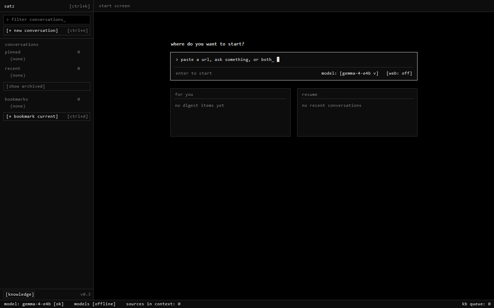

# Satz (`feamando/satz-browser`) — v0.4: Secure, Faster, Mail

**Satz** is a local-first, terminal-aesthetic AI-native desktop browser where **conversations are the workspace**, **tabs live inside a conversation**, and **Mail is a first-class pinned surface**.

Built on **Tauri v2** (`WebView2` on Windows 11, `WKWebView` on macOS) and powered by local models from [`feamando/sgs`](https://github.com/feamando/sgs) (**Gemma 4 E4B**, **Planck 3.0**, **Hertz 1.2**, **Planck 1.3/1.5** cross-readers, and a local **DistilBERT** 4-label mail classifier), Satz turns every browsed page and synced email into a checked source that you can query, compare, and cite inline with `[1]`, `[2]`, `[3]`.



---

## What Changed in v0.4 (`docs/PLAN_v0.4.md`)

1. **Security Hardening (M8):**
   - **Authenticated Sidecar (`X-Satz-Token`), `Host` Check & Strict CORS:** Tauri generates a 32-byte random CSPRNG hex token at startup (`SATZ_SIDECAR_TOKEN`) and passes it only to the `"main"` webview (`get_sidecar_config`). Every sidecar route except `GET /health` requires a constant-time verified `X-Satz-Token` header (`401 Unauthorized` otherwise), validates `Host` against `127.0.0.1:<port>` / `localhost:<port>` (`403 Forbidden` against DNS rebinding), and restricts `Access-Control-Allow-Origin` to `http://tauri.localhost`, `tauri://localhost`, and `http://localhost:1420`.
   - **Encrypted Vault (`vault.enc`), OS Keychain Device Key & Lockout:** Profile credentials in `profiles/<id>/vault.enc` are encrypted with `AES-256-GCM` using a key derived from `Argon2id(PIN, salt16, t=3, m=64 MiB, p=4)` combined via `HKDF-SHA256` with a per-profile 32-byte random `device_key` stored in the OS keychain (`keyring`, service `satz-browser`). PIN verification is authenticated decryption of `vault.enc` (no stored PIN hash), with exponential lockout after 5 wrong PINs (`30s` doubling up to `1h`) and 30-minute inactivity autolock. Legacy v0.3 `.env` profiles migrate automatically on first unlock.
   - **Exact-Host Autofill on User Action Only:** Credentials never auto-fill on page load. When a page contains a visible password field and matches an exact host or subdomain in the vault, the toolbar shows `[fill login]` (`Mod+Shift+L`), verifying `window.location.origin === expectedOrigin` in the top frame and never auto-submitting.
   - **Read/Act Boundary & Brain Proposals:** `<brain_store>` tags inside page or email source text are neutralized to `‹brain_store›`. Model-emitted `<brain_store>` directives become `[accept] [reject]` proposals unless the user's own prompt explicitly asked to store/save/remember.

2. **Speed & Context Assembly (M9):**
   - **Per-Tab Capture Cache & Shared `800 ms` Deadline:** On send, Satz recaptures only the visible tab(s) and any tab whose URL changed since its last capture, waiting on all capture receivers against a single shared `800 ms` deadline (`174–183 ms` for 1, 4, and 8 open tabs).
   - **Gemma Background Preload:** Preloads `gemma-4-e4b` in a background thread on startup (`preload_gemma: true`) and displays `gemma [warm]` in the status bar (`1.73 s` first-token latency over a 40k-char page).
   - **Brain Cache (`<= 3,000` chars) & Ranked Long-Page Passages:** Caches `BRAIN.md` by `mtime`, ranks entities with `make_encoder("planck")`, and caps the Brain prompt section at `3,000` chars. Long tabs (`> 6,000` chars) send the `1,500`-char lede plus top passages from `rank_passages(question, [doc], k=8)`.
   - **Byte-Identical System Prompt & Rolling Summary:** Keeps `STATIC_SYSTEM_PROMPT` byte-identical across turns (`system -> Brain -> sources -> history -> user`) and summarizes conversations (`<= 600` chars) after every 6th assistant turn.

3. **Citation Verification, Bookmark Change Detection & Error Ring Buffer (M10):**
   - **Post-Stream Citation Check (`check_citations`):** Splits answers into sentences and verifies every `[n]` citation: out-of-range markers become `[unsourced]`, and sentences with numbers, dates, or capitalized names absent from source `n` show `[n?]` with a tooltip listing missing tokens.
   - **Sources Panel Stats & Bookmark Conditional Fetch:** Context pills and the sources panel show `chars_sent / chars_captured`, `cut`, and `captured hh:mm`. Bookmarks refresh at a 30-minute minimum interval using `If-None-Match` / `If-Modified-Since` + SHA-256 hash deduplication, per-domain exponential backoff (`60s` to `6h`), and `changed: <bookmark title>` items in `For you`.
   - **Error Ring Buffer:** Captures the last 50 sidecar/indexer errors in `/health` and surfaces `[N errors]` in the status bar with a click-to-view overlay.

4. **Mail Surface (`satz_mail.py`, `satz_mail_pipeline.py`, `src/mail.ts`) (M11–M14):**
   - **Pinned `Mail` Conversation & Four Lanes:** `Mail` is pinned at the top of the left rail (`mail (12)`) with four native lane views:
     - `[inbox]`: Real human emails (`0 email`) with `reply` and `due MM-DD` action tags.
     - `[pings]`: Platform notifications (`1 ping`) grouped by platform (`GitHub`, `Linear`, `Slack`, `LinkedIn`, ...) and author.
     - `[orders]`: Order & shipping updates (`2 information`) grouped by order card (merchant, order number, status, tracking link, total, linked emails).
     - `[promos]`: Marketing & newsletters (`3 promotion`) kept out of the inbox and grouped by company with active voucher codes, discount value, expiry date, and one-click `[copy]`.
   - **Background Processing Pipeline:** Splits emails (`new`, `quote`, `signature`, `footer` in English and German), classifies with a local 4-label DistilBERT model (`>= 0.90` threshold required for `promotion`, cold-start bootstrapped from Gemma at `>= 50` labels and retrained every `20` user corrections), extracts structured fields with regex rules + Hertz reader fallback, and links `person` (only after user reply or `>= 2` emails), `organization`, `order`, and `promotion` entities in the Brain.
   - **`satzmail://` Custom Scheme & Strict CSP:** Email tabs load `satzmail://message/<id>` with sanitized HTML and `Content-Security-Policy: default-src 'none'; img-src data: cid:; style-src 'unsafe-inline'; font-src data:`. No scripts and no remote tracking pixels fire unless the user explicitly clicks `[load remote images]` for that sender.
   - **Compose Tab & SMTP Send Gate:** Plain-text compose tab (`[draft with gemma]`) with a mandatory confirmation gate (`POST /mail/send/prepare` -> `[confirm] [cancel]` with `[new]` recipient badge -> single-use `confirm_token` -> 10-second `[undo]` window -> `smtplib` delivery + `\Answered` + `APPEND` to Sent, capped at 20 sends/hour/account).
   - **Mail Intelligence & Eval Mode:**
     - Mail `chat` tab opens with a cited triage overview (`GET /mail/triage`) over unread/reply-needed emails, recent orders, and expiring promo codes.
     - Normal conversations have a `[mail: on/off]` toggle next to `[web: on/off]` that injects top 5 FTS5 matches from `mail.sqlite`.
     - Site tabs automatically show `[codes (N)]` in the toolbar when visiting a merchant domain with active promo codes.
     - Settings -> Mail includes **Eval Mode** (`GET /mail/eval`, `POST /mail/eval/label`, `GET /mail/eval/report`) sampling 200 stratified emails (excluded from training) and reporting the 4x4 confusion matrix and gate metrics.

---

## Mail Setup & App Passwords

Mail accounts are stored per profile (`profiles/<id>/mail.sqlite`) and require your profile vault to be unlocked with its 6-digit PIN. Passwords are stored exclusively in `vault.enc` under `<PREFIX>_USERNAME`, `<PREFIX>_PASSWORD`, `<PREFIX>_IMAP_HOST`, and `<PREFIX>_SMTP_HOST`.

| Preset | Incoming | Outgoing | Notes |
| :--- | :--- | :--- | :--- |
| **Gmail** | `imap.gmail.com:993` (SSL) | `smtp.gmail.com:587` (STARTTLS) | Requires a 16-character Google **App Password** (2-Step Verification enabled -> Google Account -> Security -> App passwords). |
| **Outlook / Hotmail** | `outlook.office365.com:993` (SSL) | `smtp.office365.com:587` (STARTTLS) | Requires an Microsoft **App Password** if basic auth is enabled on the account. |
| **iCloud** | `imap.mail.me.com:993` (SSL) | `smtp.mail.me.com:587` (STARTTLS) | Requires an Apple ID **App-Specific Password** (`appleid.apple.com`). |
| **GMX** | `imap.gmx.net:993` (SSL) | `mail.gmx.net:587` (STARTTLS) | Enable IMAP/POP3 access in GMX Mail settings. |
| **WEB.DE** | `imap.web.de:993` (SSL) | `smtp.web.de:587` (STARTTLS) | Enable IMAP/POP3 access in WEB.DE settings. |
| **Custom IMAP** | `<host>:993` (SSL / STARTTLS) | `<host>:587` (STARTTLS / SSL) | Uses `SELECT readonly` + `BODY.PEEK` during sync. |
| **Custom POP3** | `<host>:995` (SSL) | `<host>:587` (STARTTLS / SSL) | Uses `UIDL` deduplication; never calls `DELE` ("leave on server" forced). |

To add an account:
1. Open `[knowledge · profile]` in the bottom-left rail and unlock your profile with your 6-digit PIN.
2. Scroll to **mail accounts**, choose a preset, enter your email and app password, and click `[test]` to verify both incoming and outgoing (`SMTP EHLO + AUTH`) login.
3. Click `[+ add account]` to save credentials to `vault.enc` and start background sync (last 30 days, max 2,000 messages).

---

## Keyboard Shortcuts (`Mod` = `Ctrl` on Windows, `Cmd` on macOS)

### Global Browser Shortcuts
| Shortcut | Action |
| :--- | :--- |
| `Mod+N` | New conversation (Start Screen) |
| `Mod+K` | Filter conversations in the left rail |
| `Mod+T` | New site tab in the active conversation (focuses address bar) |
| `Mod+W` | Close active site/email/compose tab (`chat` tab cannot be closed) |
| `Mod+1` | Switch to `[1 chat]` tab |
| `Mod+2` .. `Mod+9` | Switch to tab `2` .. `9` |
| `Mod+L` | Focus address bar of the current site tab |
| `Mod+Shift+L` | Fill login credentials from unlocked vault on exact host match (never auto-submits) |
| `Mod+J` | Toggle collapsible chat/agent rail on a site or email tab |
| `Mod+M` | Toggle Compare View (tile 2 to 4 selected tabs) |
| `Mod+D` | Bookmark the current page (hooks up 30-min background indexing) |
| `Mod+F` | Native find-in-page |
| `Esc` | Exit Compare View / clear Start Screen input |

### Mail Lane & Message Shortcuts (when no text input is focused)
| Shortcut | Action |
| :--- | :--- |
| `j` / `k` | Move selection down / up in the active mail lane |
| `Enter` | Open the selected email in a `satzmail://` tab |
| `r` | Reply to the active or selected email in a `compose` tab |
| `c` | Open a new blank `compose` tab |
| `e` | Hide (archive locally in `mail.sqlite`; never deletes on server) |
| `1` / `2` / `3` / `4` | Move message to `1 inbox` (`email`), `2 pings`, `3 orders` (`information`), or `4 promos` (records user correction) |
| `/` | Focus FTS5 mail search bar |
| `Mod+Enter` | Prepare send confirmation (`[confirm] [cancel]`) in a `compose` tab |

---

## Security Model Summary

| Boundary | Enforcement |
| :--- | :--- |
| **Sidecar HTTP (`127.0.0.1:8020`)** | Per-launch 32-byte CSPRNG token (`X-Satz-Token`), `Host` allowlist (`127.0.0.1:<port>`, `localhost:<port>`), and strict `Origin` allowlist (`http://tauri.localhost`, `tauri://localhost`, `http://localhost:1420`). |
| **Password Vault (`vault.enc`)** | `AES-256-GCM` with `HKDF-SHA256(Argon2id(PIN, salt16) || OS_keychain_device_key)`. Copying `vault.enc` to another machine/account cannot unlock it even with the 6-digit PIN. Exponential lockout (`30s` -> `1h`) after 5 failed PIN attempts; 30-minute inactivity autolock. |
| **Login Autofill** | Strict exact-host or subdomain match (`host_matches_allowed`), user-triggered only (`[fill login]` / `Mod+Shift+L`), top-frame `window.location.origin` check, no auto-submit. |
| **Email Rendering (`satzmail://`)** | Sanitized HTML served with `Content-Security-Policy: default-src 'none'; img-src data: cid:; style-src 'unsafe-inline'; font-src data:`. Scripts, iframes, event handlers, and remote tracking pixels are stripped/blocked by default. |
| **Read / Act Boundary** | Page and email text never authorizes actions. `<brain_store>` in sources is neutralized (`‹brain_store›`). Model Brain writes without explicit user store intent become `[accept] [reject]` proposals. Outgoing SMTP mail requires a user click on `[confirm]` with a single-use 2-minute `confirm_token`, followed by a 10-second `[undo]` window and a 20 sends/hour rate limit. |

---

## Repository Structure

```text
satz-browser/
├── .gemini/
│   └── antigravity.md                # Workspace rules
├── docs/
│   ├── PLAN_v0.4.md                  # Full Satz v0.4 specification (M8-M15)
│   ├── NOTES_v0.4.md                 # v0.4 milestone measurements, timings & 200-email eval report
│   ├── PLAN_v0.3_working_browser.md  # Satz v0.3 specification
│   ├── NOTES_v0.3.md                 # Satz v0.3 verification notes
│   └── screenshots/
│       └── m1.png                    # Terminal UI screenshot
├── public/
│   └── fonts/                        # Bundled JetBrains Mono (Regular & Bold woff2)
├── sidecar/
│   ├── satz_models.py                # Local model HTTP sidecar (auth, speed, citation check, chat, digest)
│   ├── satz_brain.py                 # Satz Brain entity graph, proposals, Planck encoder ranking
│   ├── satz_passwords.py             # Argon2id + OS keychain + AES-256-GCM vault.enc & exact-host match
│   ├── satz_mail.py                  # Mail accounts, IMAP PEEK / POP3 UIDL sync, lanes, satzmail://, SMTP gate, eval mode
│   ├── satz_mail_pipeline.py         # 4-part EN/DE splitter, DistilBERT + Gemma classifier, rule + Hertz extractor
│   └── test_satz_models.py           # Comprehensive unit test suite (M5-M14)
├── src/                              # Modular TypeScript frontend (13 modules)
│   ├── main.ts                       # App shell orchestration, mail/site/compose viewports & codes (N) pill
│   ├── mail.ts                       # Mail lanes (inbox/pings/orders/promos), accounts, compose, eval mode
│   ├── api.ts                        # Tauri invoke + authenticated sidecar HTTP/SSE client (X-Satz-Token)
│   ├── state.ts                      # App state + URL/prompt classifier + active tab sources
│   ├── rail.ts                       # Left rail (pinned Mail with unread count, pinned, recent, bookmarks)
│   ├── start.ts                      # Start screen (input, model picker, For you digest, resume)
│   ├── tabs.ts                       # Per-conversation tab strip + Mail lane tabs + webview bounds sync
│   ├── chat.ts                       # Chat thread, mail/web toggles, triage overview, [n] citations, proposals
│   ├── sources.ts                    # Active tab context panel (chars_sent/captured, cut badge, captured hh:mm)
│   ├── knowledge.ts                  # Profiles, encrypted vault.enc, mail accounts, Brain index & passages
│   ├── keys.ts                       # Cross-platform Mod keyboard shortcuts (including Mod+Shift+L)
│   ├── status.ts                     # Bottom status line (gemma [warm], mail progress, [N errors] overlay)
│   ├── types.ts                      # Shared TypeScript interfaces
│   └── style.css                     # Strict terminal black & white CSS variables
├── src-tauri/                        # Rust + Tauri v2 backend
│   ├── capabilities/
│   │   └── default.json              # Scoped strictly to "main" webview
│   └── src/
│       ├── db.rs                     # SQLite schema + migrations (conversations.summary, messages citations, tabs.kind, Mail)
│       ├── webview_manager.rs        # Per-tab WebView2 manager, capture cache, shared 800ms deadline, autofill check
│       ├── lib.rs                    # CSPRNG token generation, satzmail:// scheme handler, sidecar spawn
│       └── main.rs                   # Application entry point
└── package.json
```

---

## Building, Testing & Running

### 1. Build & Run All Verification Suites
```powershell
# Frontend TypeScript + Vite build
npm run build

# Rust compile & unit tests (schema migrations, Mail protections, capture cache, shared deadline)
cargo check --manifest-path src-tauri/Cargo.toml --offline
cargo test --manifest-path src-tauri/Cargo.toml --offline

# Python sidecar pytest suite (M5 through M14: security, speed, quality, mail sync, pipeline, send gate, eval report)
..\sgs\.venv\Scripts\python.exe -m pytest sidecar -q
```

### 2. Sidecar Settings (`%APPDATA%\com.satz.browser\settings.json`)
Tauri spawns `sidecar/satz_models.py` automatically on startup with `SATZ_SIDECAR_TOKEN` and terminates it on exit. Default settings are stored in `%APPDATA%\com.satz.browser\settings.json`:
```json
{
  "sgs_root": "..\\sgs",
  "python": "..\\sgs\\.venv\\Scripts\\python.exe",
  "gemma_path": "models/gemma-4-e4b-it",
  "port": 8020,
  "max_live_tabs": 8,
  "preload_gemma": true,
  "bookmark_interval_minutes": 30,
  "vault_autolock_minutes": 30
}
```
