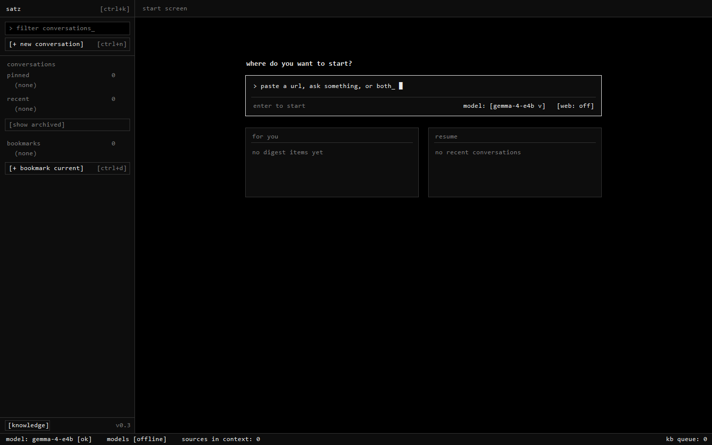

# Satz (`feamando/satz-browser`) — v0.3 Working Browser

**Satz** is a local-first, terminal-aesthetic AI-native desktop browser where **conversations are the workspace** and **tabs live inside a conversation**.

Built on **Tauri v2** (`WebView2` on Windows 11, `WKWebView` on macOS) and powered by local models from [`feamando/sgs`](https://github.com/feamando/sgs) (**Gemma 4 E4B**, **Planck 3.0**, **Hertz 1.2**, and **Planck 1.3/1.5** cross-readers), Satz turns every browsed page in a conversation into a checked source that you can query, compare, and cite inline with `[1]`, `[2]`, `[3]`.



---

## What Changed in v0.3 (`docs/PLAN_v0.3_working_browser.md`)

1. **Terminal Look (Strict Black & White):**
   - Pure black `#000000` background, `#0d0d0d` panel surface, `#333333` `1px` borders, `#e8e8e8` foreground, bundled `JetBrains Mono` monospace font everywhere, `border-radius: 0`, and inverse-video selection (`background: var(--fg); color: var(--bg)`).
2. **Tabs Inside Conversations (`chat` + Site Tabs):**
   - Every conversation starts with a pinned `[chat]` tab (Tab 1) followed by normal browser site tabs (`[2]`, `[3]`, ...).
   - Each site tab has its own persistent native `WebView2` / `WKWebView` (`tab-<id>`) so switching tabs or conversations preserves scroll position, video playback, and history without reloading.
   - Live child webviews are capped at `8` (`max_live_tabs`) via LRU eviction; hidden tabs above the cap suspend cleanly and reload when revisited.
   - Site tabs include a collapsible **agent rail** (`Mod+J`) on the right and **Compare mode** (`Mod+M`) tiling 2 to 4 selected tabs side-by-side.
3. **Unified Start Screen & Direct Browsing:**
   - One input routes automatically:
     - **URL only** (`dw.com`, `https://...`, `localhost:3000`): opens a `direct` conversation on the site tab immediately with the agent rail collapsed (auto-archived after 24h if untouched).
     - **Question only** (`what's new on the Greenland story`): opens the `chat` tab and answers with the selected local model.
     - **URL + Question** (`nytimes.com/... summarize the main argument`): opens the URL as a tab/source and answers the prompt on the `chat` tab.
4. **Sources as Context & Inline Citations:**
   - Every page visited in a conversation's tabs is captured (via native `WebView2` `ExecuteScript` DOM capture on Windows, with `Web.fetch` fallback) and extracted to clean text via `trafilatura`.
   - Checked sources in the `sources` panel are assembled into Gemma's context (`6,000` chars per open tab, top 3 passages per closed checked source up to `24,000` chars total).
   - Clicking an inline `[n]` citation in chat switches directly to that tab (or reopens it).
5. **Local Model Sidecar (`sidecar/satz_models.py` on `127.0.0.1:8020`):**
   - Zero cloud models, zero external LLM API keys.
   - Four local model options in the picker:
     - `gemma-4-e4b` (default): local Gemma 4 E4B (`bfloat16` on GPU) streaming SSE answers with `[n]` citations (`~229 ms` warm first-token latency on RTX 4090).
     - `planck3 (web)`: Planck 3.0 web search -> read -> weigh -> write pipeline (`Hertz` int8 reader + `Template` writer + source trust registry).
     - `hertz (reader)`: Hertz cross-reader (`checkpoints/xreader_hertz_rc/reader.pt`, `int8` on CPU) for factual extraction over checked conversation sources.
     - `planck (reader)`: Planck cross-reader (`checkpoints/xreader_planck_rc/reader.pt`, `int8` on CPU) for side-by-side comparison.
6. **Satz-Owned Knowledge Base (`%APPDATA%\com.satz.browser\planck_store.sqlite`):**
   - Background ingest worker indexes browsed passages, entity co-mentions, domain visits, and dwell time to power `for you` (`GET /digest`) and the `knowledge` view (`pause learning`, per-passage delete, and per-conversation `/forget`).

---

## Keyboard Shortcuts (`Mod` = `Ctrl` on Windows, `Cmd` on macOS)

| Shortcut | Action |
| :--- | :--- |
| `Mod+N` | New conversation (Start Screen) |
| `Mod+K` | Filter conversations in the left rail |
| `Mod+T` | New site tab in the active conversation (focuses address bar) |
| `Mod+W` | Close active site tab (`chat` tab cannot be closed) |
| `Mod+1` | Switch to `[1 chat]` tab |
| `Mod+2` .. `Mod+9` | Switch to site tab `1` .. `8` |
| `Mod+L` | Focus address bar of the current site tab |
| `Mod+J` | Toggle collapsible chat/agent rail on a site tab |
| `Mod+M` | Toggle Compare View (tile 2 to 4 selected tabs) |
| `Mod+D` | Bookmark the current page |
| `Mod+F` | Left to the page (native find-in-page) |
| `Esc` | Exit Compare View / clear Start Screen input |

---

## Repository Structure

```text
satz-browser/
├── .gemini/
│   └── antigravity.md           # Workspace rules (v0.3)
├── docs/
│   ├── PLAN_v0.3_working_browser.md  # Full Satz v0.3 specification
│   ├── PLANNING_v0.2.md         # Satz v0.2 roadmap specification
│   ├── NOTES_v0.3.md            # Milestone verification notes & measurements
│   └── screenshots/
│       └── m1.png               # Terminal UI screenshot
├── public/
│   └── fonts/                   # Bundled JetBrains Mono (Regular & Bold woff2)
├── sidecar/
│   ├── satz_models.py           # Local model HTTP sidecar (127.0.0.1:8020)
│   └── test_satz_models.py      # Unit tests for M5, M6, M7 sidecar endpoints
├── src/                         # Modular TypeScript frontend (11 modules)
│   ├── main.ts                  # App shell orchestration & region rendering
│   ├── api.ts                   # Tauri invoke + sidecar HTTP/SSE client
│   ├── state.ts                 # App state + URL/prompt start classifier
│   ├── rail.ts                  # Left rail (pinned, recent, archived, bookmarks)
│   ├── start.ts                 # Start screen (input, model picker, for you, resume)
│   ├── tabs.ts                  # Per-conversation tab strip + webview bounds sync
│   ├── chat.ts                  # Chat thread, streaming composer, [n] citations
│   ├── sources.ts               # Sources panel & in-context checkboxes
│   ├── knowledge.ts             # Knowledge base inspector & pause learning toggle
│   ├── keys.ts                  # Cross-platform Mod keyboard shortcuts
│   ├── status.ts                # Bottom status line
│   ├── types.ts                 # Shared TypeScript interfaces
│   └── style.css                # Strict terminal black & white CSS variables
├── src-tauri/                   # Rust + Tauri v2 backend
│   ├── capabilities/
│   │   └── default.json         # Scoped strictly to "main" webview
│   └── src/
│       ├── db.rs                # SQLite Schema v2 + v1->v2 migration + unit tests
│       ├── webview_manager.rs   # Per-tab WebView2 manager, 8-tab LRU cap, DOM capture
│       ├── lib.rs               # Tauri commands, app menu accelerators, sidecar spawn
│       └── main.rs              # Application entry point
└── package.json
```

---

## Building, Testing & Running

### 1. Build & Run Unit Tests
```powershell
# Frontend TypeScript + Vite build
npm run build

# Rust Schema v2, migration, dedupe, URL classifier, and LRU cap unit tests
cargo test --manifest-path src-tauri/Cargo.toml --offline

# Python sidecar unit tests (M5/M6/M7)
..\sgs\.venv\Scripts\python.exe sidecar\test_satz_models.py -v
```

### 2. Sidecar Settings (`%APPDATA%\com.satz.browser\settings.json`)
Tauri spawns `sidecar/satz_models.py` automatically on startup and terminates it on exit. Default settings are written to `%APPDATA%\com.satz.browser\settings.json`:
```json
{
  "sgs_root": "..\\sgs",
  "python": "..\\sgs\\.venv\\Scripts\\python.exe",
  "gemma_path": "models/gemma-4-e4b-it",
  "port": 8020,
  "max_live_tabs": 8
}
```
You can also run the sidecar standalone:
```powershell
..\sgs\.venv\Scripts\python.exe sidecar\satz_models.py --sgs-root ..\sgs --port 8020
```
