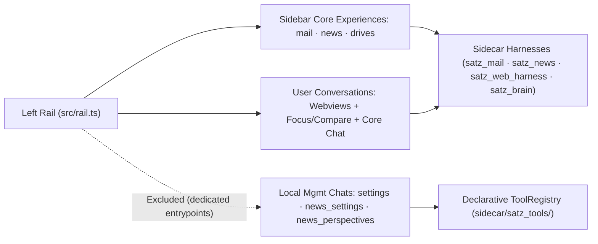

# Satz Browser High-Level System Overview & Harness Architecture

See also: [ARCHITECTURE.md](ARCHITECTURE.md) · [PLATFORMS.md](PLATFORMS.md) · [RELEASE_RUNBOOK.md](RELEASE_RUNBOOK.md) · [../agents/INSTRUCTIONS.md](../agents/INSTRUCTIONS.md)

## 1. Core Experience & Surface Separation

Satz organizes the desktop browser around **three cleanly separated conversational and execution surfaces**, enforced across [src/rail.ts](../../src/rail.ts), [src-tauri/src/db.rs](../../src-tauri/src/db.rs), and [sidecar/satz_tools/](../../sidecar/satz_tools/__init__.py):

1. **Sidebar Core Experiences & Harnesses (`systemPinned` in `src/rail.ts`):**
   Pinned at the top of the left sidebar above a separator (`origin` in `"mail"`, `"news"`, `"drives"`):
   - **Mail (`origin: "mail"`):** Local-first IMAP/POP3 email client & pipeline (`src/mail.ts`, `sidecar/satz_mail.py`, `sidecar/satz_mail_pipeline.py`) with 4-label classification (`email`, `ping`, `information`, `promotion`), extracted verification/tracking/promo pills, `satzmail://` rendering, and confirmation-gated reply/unsubscribe actions.
   - **News (`origin: "news"`):** Multi-source read-weigh-write digest and perspective reader (`src/news.ts`, `sidecar/satz_news.py`) with trust-blind extraction, source-family deduplication, hard `30%` personal trust cap (`0.7 * system + 0.3 * user`), and balanced viewpoint spreads.
   - **Drives & Harnesses (`origin: "drives"` + command/action pipelines):** Workspace connectors and structured multi-step workflows separated cleanly from casual browsing threads.

2. **Core Chats Within Conversations (`userPinned`, `recent`, `archived`):**
   Each user conversation replaces traditional tab clutter with an intent-anchored workspace pairing live browser tabs (`WebView2` on Windows, `WKWebView` on macOS via `WebviewManagerState`) in single-tab Focus Mode or 2–4 tile Compare Mode with a grounded side chat ([src/chat.ts](../../src/chat.ts)):
   - Live authenticated DOM capture (`apiCaptureOpenTabs`) feeds the conversation context as numbered `SOURCES [1], [2], ...`.
   - Grounded web research runs through [sidecar/satz_web_harness.py](../../sidecar/satz_web_harness.py) (`WebSearchSessionHarness`, anaphora query resolution, tool-calling loops for `web_search` / `fetch_webpage`, `read_source` deep passage inspection, and citation validation).
   - User-selected local models (`gemma`, custom Hugging Face / local checkpoints via `sidecar/satz_local_models.py`), shipped Planck (`sidecar/planck_vendor/` + `sidecar/models/planck/`), or opt-in cloud models generate cited answers fused with `[B1], [B2]` memory from Satz Brain (`sidecar/satz_brain.py`).

3. **Dedicated Local Chats for Settings & News Management (`origin` in `"settings"`, `"news_settings"`, `"news_perspectives"`):**
   Excluded from the sidebar conversation list ([src/rail.ts](../../src/rail.ts#L64-L70)) so configuration stays focused and isolated from untrusted web/email inputs:
   - Opened intentionally from footer Settings (`conv-settings`) or News management headers (`news_settings`, `news_perspectives`).
   - Executed via declarative `@satz_tool` / `ToolRegistry` modules in [sidecar/satz_tools/](../../sidecar/satz_tools/__init__.py) (`settings_models.py`, `settings_i18n.py`, `settings_mail.py`, `settings_oauth.py`, `settings_profiles.py`, `settings_providers.py`, `settings_status.py`, and `news_settings.py`).
   - Enforces origin-isolation guards (`conversation_origin` checks), RAM-only secret staging cleared on `/profile/lock`, interactive inline `ui_cards`, and single-use `confirm_gate` tokens.

---

## 2. Core Components & Runtime Harnesses

| Layer | Component | Responsibility |
| :--- | :--- | :--- |
| **Desktop Shell (`src-tauri/`)** | `lib.rs`, `webview_manager.rs`, `db.rs` | Tauri v2 window/child-webview bounds, `satz.db` persistence, OS keychain/Credential Manager bridges, `satzmail://`, `prepare_for_update` sidecar teardown, `tauri-plugin-updater`. |
| **Frontend UI (`src/`)** | `main.ts`, `rail.ts`, `tabs.ts`, `chat.ts`, `mail.ts`, `news.ts`, `knowledge.ts`, `updater.ts` | Tokenized CSS design system (`src/design-system/`), `EN_CATALOG` + live localized bundles (`src/i18n/`), sidebar + conversation views, Settings cards, updater UI. |
| **Model & Search Harnesses (`sidecar/`)** | `satz_models.py`, `satz_local_models.py`, `satz_web_harness.py` | Local + cloud model routing, shipped Planck (`<90 MB` shards, zero `../sgs`), HF downloader, web search/fetch tool loops, DOM capture hydration, citation checks. |
| **Knowledge, Mail & News (`sidecar/`)** | `satz_brain.py`, `satz_mail_pipeline.py`, `satz_news.py` | Personal Markdown + SQLite/Planck13 Brain graph, IMAP/POP3 classifier & extractors, multi-source read-weigh-write News engine. |
| **Safety, Evals & Telemetry (`sidecar/`)** | `satz_tools/`, `satz_evals.py`, `satz_telemetry.py` | Declarative Settings/News tools, prompt-injection red-team gates, regression capture, per-instance `<app_data_dir>/dev/` telemetry. |
| **Dev Pipeline (`dev/` & `scripts/`)** | `dev_brain.py`, `release_version.py`, `agent_background_worker.py`, `dev/agents/` | Dev Brain graph index, Windows/macOS release & semver CLI, cross-harness Antigravity/Claude hooks, skills, behavior/error learning, and eval gates. |
